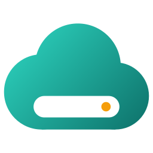

<p align="center">
  
</p>

<h1 align="center">OpenCfDrive</h1>

<p align="center">
  <b>Any rclone remote, as a cloud drive in Windows Explorer.</b><br>
  Files on demand, the way OneDrive does it, for S3, WebDAV, SFTP
  and every other backend rclone supports.
</p>

<p align="center">
  <a href="https://github.com/dkgs2000/OpenCfDrive/releases/latest"></a>
  <a href="https://github.com/dkgs2000/OpenCfDrive/actions/workflows/test.yml"></a>
  <a href="LICENSE"></a>
</p>

---

## Why OpenCfDrive

- **Built into Explorer.** Your remote gets its own entry in Explorer's
  navigation pane. OpenCfDrive uses the same Windows Cloud Files API as
  OneDrive, so it needs no drive letter, FUSE layer or extra driver.
- **Files on demand.** Every file shows up right away and downloads only when
  you open it. **Free up space** and **Always keep on this device** are in the
  right-click menu.
- **Two-way sync.** Your adds, edits, renames, moves and deletes go to the
  server. Changes made on the server show up within 30 seconds in folders
  holding files you downloaded or keep on this device, and in other folders
  when you next open them.
- **Works offline.** Files you downloaded still open. Edits, renames and
  deletes you make offline go to the server when it's back.
- **Never loses an edit.** If a file changed on both sides, OpenCfDrive keeps
  both versions.
- **Any backend.** OpenCfDrive reaches your storage only through
  [rclone](https://rclone.org). Your drive works with any storage rclone works
  with.
- **Easy on your server.** OpenCfDrive reads a folder only when you open it and
  never crawls the whole drive. Only folders with files on this PC are checked
  in the background. Your server doesn't need to send change notifications.
- **Easy to run.** The installer needs no admin rights and includes .NET. An
  icon in the notification area shows whether the drive is up to date,
  syncing or offline, and the app updates itself.

## Install

You need **64-bit Windows 10 (version 2004 or later) or Windows 11**.

1. **Download** `OpenCfDrive-<version>-x64-setup.exe` from the
   [latest release](https://github.com/dkgs2000/OpenCfDrive/releases/latest)
   and run it. The installers aren't code-signed yet, so SmartScreen may warn
   you. Choose **More info → Run anyway**.
2. **Set up your remote in rclone**, if you haven't already. The `rclone config`
   wizard asks for your server's details, or opens your browser so you can
   sign in:

   ```powershell
   winget install Rclone.Rclone
   rclone config
   ```

   Don't have rclone? Press **Download rclone from rclone.org** in
   OpenCfDrive's Settings tab instead.
3. **Pick the remote.** In OpenCfDrive's **Settings** tab, choose your remote,
   for example `myremote:` or `myremote:backup`, and press **Save**.

Your drive is now in Explorer as **OpenCfDrive**, at `%USERPROFILE%\OpenCfDrive`.

## Using it

- **Open files as usual.** A cloud icon in Explorer's Status column means the
  file is online only. Opening it downloads it, with a progress bar for big
  files.
- **The Status column also shows a file's sync state:** waiting to upload, a
  conflict copy, or couldn't sync, with the reason.
- **Right-click** a file or folder and choose **Free up space** to remove the
  local copy, or **Always keep on this device** to keep it available offline.
- **Click the OpenCfDrive icon** in the notification area to see the status
  and recent activity. Its menu opens the drive, starts and stops syncing, and
  shows the log.
- **Uninstall** from **Settings → Apps**. The drive folder stays behind as a
  normal folder with everything you downloaded.

The [user guide](docs/user-guide.md) explains every setting, offline use,
conflicts, updates and where OpenCfDrive keeps its files.

## Build from source

You need Windows and the [.NET 10 SDK](https://dotnet.microsoft.com/download).

```powershell
git clone https://github.com/dkgs2000/OpenCfDrive.git
cd OpenCfDrive
dotnet build .\OpenCfDrive.slnx
dotnet run --project .\OpenCfDrive.App
```

This builds and starts the app, and the app starts the sync service. To build
the `.exe` and `.msi` installers into `.\artifacts`, run:

```powershell
.\installer\Build-Installer.ps1 -Version 1.2.3
```

For tests, the project layout and how releases are made, see the
[development guide](docs/development.md).

## Documentation

| Guide | What's in it |
| --- | --- |
| [User guide](docs/user-guide.md) | Setup in detail, the app and its settings, offline use, conflicts, updates, file locations |
| [Development](docs/development.md) | Building and running from source, configuration, project layout, installers, CI and releases |
| [Testing](docs/testing.md) | Unit, contract and end-to-end tests, and the scenario matrix |
| [Architecture](docs/architecture.md) | How the drive works on the Cloud Files API, and the rules the code relies on |

## License

OpenCfDrive is public domain software, released under [the Unlicense](LICENSE).
It comes with no warranty. It reads, writes and deletes files on your computer
and on your remote, so keep backups of anything you can't lose.

OpenCfDrive works with [rclone](https://rclone.org) but isn't part of it. The
rclone project doesn't endorse OpenCfDrive and has no affiliation with it.
